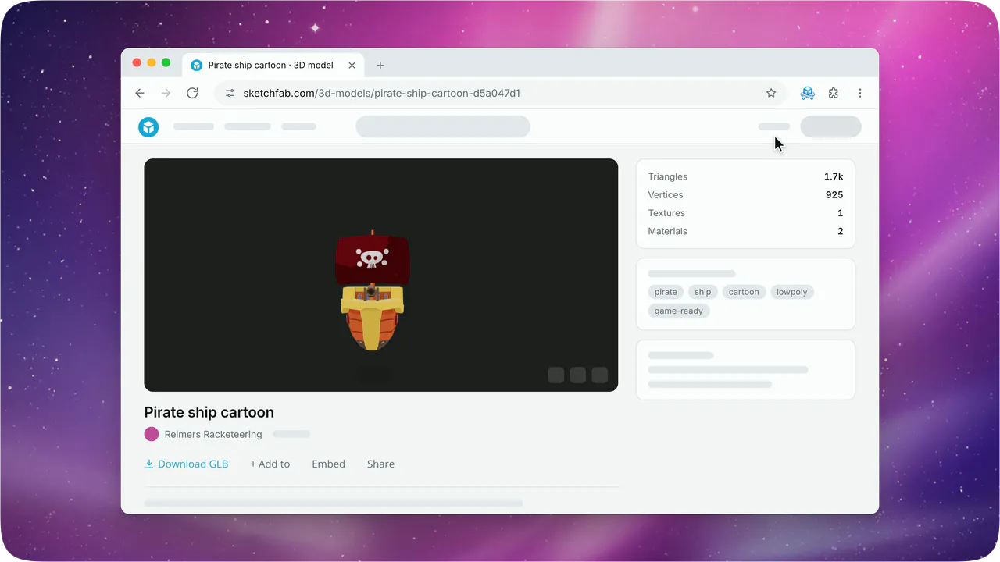
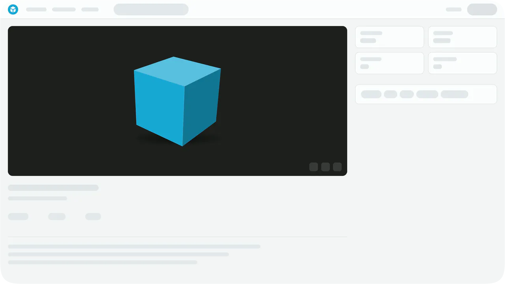
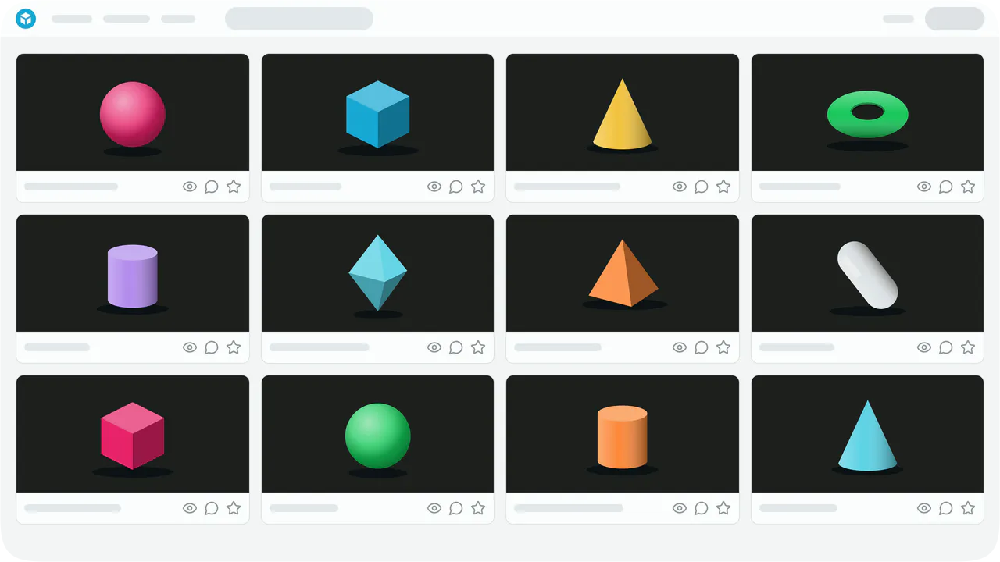
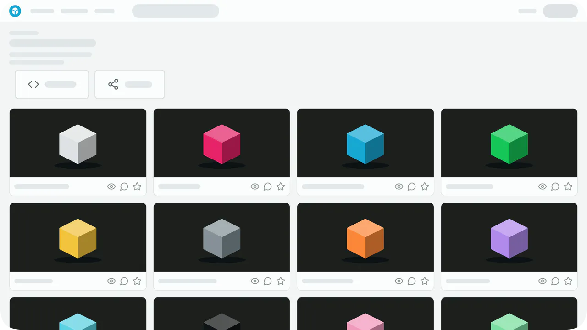

<div align="center">


# Sketchfab → glTF

Download any model already rendering in your browser as a `.glb` or `glTF` ZIP.

Sketchfab sent mesh and textures to your browser for viewing. This writes the same data to disk.

</div>



## Install

### From a release

1. Download the latest `*-chrome.zip` from [Releases](https://github.com/Hemmingsson/Sketchfab-to-gltf/releases).
2. Unzip it.
3. Open `chrome://extensions` and turn on **Developer mode**.
4. Click **Load unpacked** and select the unzipped folder (the one with `manifest.json`).

### From source

```sh
git clone https://github.com/Hemmingsson/Sketchfab-to-gltf.git
cd Sketchfab-to-gltf
pnpm install && pnpm build
```

Then **Load unpacked** → `.output/chrome-mv3`.

## Use

Download models from a page, a card, or a whole collection.
<table>
<tr>
<td width="33%" valign="top">



On a model page, click **Download GLB** next to **+ Add to** below the preview.

</td>
<td width="33%" valign="top">



On search and browse grids, click the download icon in a card’s top-right corner.

</td>
<td width="33%" valign="top">



On a collection, click **Download all** in the header actions to queue every model.

</td>
</tr>
</table>

## How it works



[Decrypt](https://github.com/seryi882/sketchfab-downloader-extension/blob/main/lib/decrypt.js) and [descramble](https://github.com/seryi882/sketchfab-downloader-extension/blob/main/lib/descramble.js) approach from [seryi882](https://github.com/seryi882/sketchfab-downloader-extension).

## Development

```sh
pnpm dev          # watch build → .output/chrome-mv3-dev (load that folder while developing)
pnpm playground   # UI preview on a mock backend
pnpm check        # typecheck
pnpm test         # unit tests for the conversion engine in src/lib
```

See [AGENTS.md](AGENTS.md) for layout, rules, and conventions.

## Legal

Follow [Sketchfab's Terms](https://sketchfab.com/terms) and each model's license.

## License

This project is licensed under the [GNU General Public License v3.0](LICENSE).
